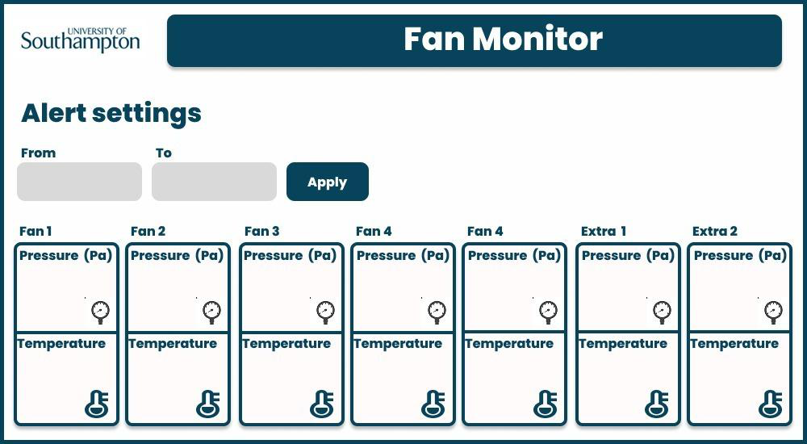
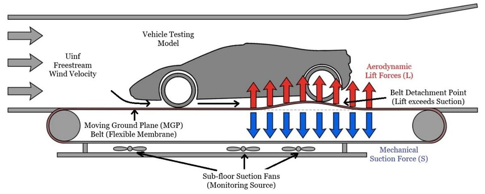
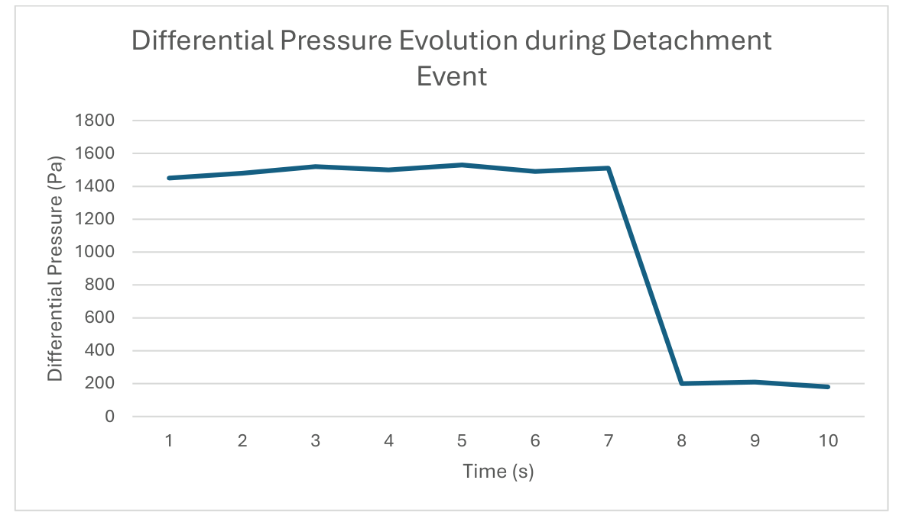
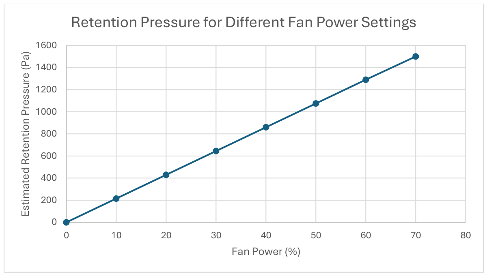

# Wind Tunnel IIoT Monitor

[](https://github.com/NMalkovCode/wind-tunnel-iiot-monitor/actions/workflows/tests.yml)


[](LICENSE)

**A real-time pressure monitoring and alert system that warns wind tunnel operators before the
rolling-road belt lifts off.** Built on a Raspberry Pi 4, Honeywell digital pressure sensors and
Python, and commissioned in the R.J. Mitchell Wind Tunnel at the University of Southampton.

This is the software from my final-year individual project (FEEG3003, Aeronautical and
Astronautical Engineering, University of Southampton, May 2026): *"Wind Tunnel Pressure Sensor and
Alert System: An IIoT Architecture for Moving Ground Plane Monitoring"*, supervised by David
Marshall.


<sub>The operator interface layout used in the tunnel: one panel per suction fan zone, with live
pressure and temperature.</sub>

## The problem

Car models are tested in the wind tunnel on a **Moving Ground Plane (MGP)**, or rolling road: a
belt running at wind speed, so the floor does not build a boundary layer under the car. Five sub-floor
suction fans hold the belt flat against the platen.

Modern ground-effect and "fan car" models (think Gordon Murray T.50 or McMurtry Spéirling) create
strong suction under the floor that pulls the belt **upwards**. If that lift beats the fans'
retention suction, the belt flutters and can detach, wrecking the model, damaging the facility and
silently invalidating the test data. Operators had no live view of the sub-floor pressure, and a
detachment develops faster than a person can react.



## What it does

```
 7 x Honeywell HSC I²C sensors (one per fan zone + 2 spare)
        │  1 m silicone tubing from existing pressure taps (acts as a low-pass filter)
        ▼
 TCA9548A I²C multiplexer ──► Raspberry Pi 4
        │
        ▼  JSON over MQTT, topic fan_monitor/data
 ┌─────────────────────── this repository ───────────────────────┐
 │  network thread  ──►  alert engine  ──►  GUI (main thread)    │
 │  (paho-mqtt)          5-sample moving      CustomTkinter,     │
 │                       average + dP/dt      red = detachment   │
 └───────────────────────────────────────────────────────────────┘
```

1. **Receives** live pressure and temperature for each of the 7 sensors from an MQTT broker.
2. **Smooths** each sensor's pressure with a simple moving average, so turbulent buffeting and
   single noisy samples do not cause false alarms.
3. **Detects** the signature of a detachment: a rapid, sustained *drop* in the smoothed pressure
   (a negative dP/dt below -50 Pa per sample), rather than a fixed threshold that turbulence
   would keep tripping.
4. **Shows** the operators a live dashboard; the affected fan zone turns red the moment the
   signature is detected.

Networking runs on a background daemon thread and every GUI update is handed back to the main
thread with `after(0, ...)`, so the interface never freezes while waiting for data.

## Results from commissioning

| | |
|---|---|
| **Detection** | Simulated detachments (retention suction cut) were flagged every time, with no false positives from normal belt vibration. |
| **Latency** | Sensor-to-dashboard network latency consistently under 15 ms, zero packet loss. |
| **Load on the Pi** | ~18% average CPU and ~145 MB RAM (under 4% of 4 GB); CPU stayed well below the 80 °C throttling limit. |
| **New facility limit** | The suction fans give **~1500 Pa of retention at 70% power**. Above that, belt-on-platen friction stalls the belt drive motors, so 1500 Pa is the tunnel's real ceiling, not the fans' capacity. Models must keep their under-floor suction below this. |
| **Accuracy** | Total measurement uncertainty ±2.35% (root-sum-square), i.e. about ±35 Pa at 1500 Pa. |
| **Hardware cost** | £392.53 in total, compared with thousands for an aerospace pressure scanner and PLC. |

<p>
  
  
</p>

More detail: [docs/results.md](docs/results.md).

## Quick start (no hardware needed)

You can run the whole system on a laptop: a simulator publishes fake sensor data, including a
detachment every 10 seconds.

**You need:** Python 3.10+ and an MQTT broker. [Eclipse Mosquitto](https://mosquitto.org/download/)
is free (Windows installer; `brew install mosquitto` on macOS; `sudo apt install mosquitto` on
Debian, Ubuntu or Raspberry Pi OS).

```bash
git clone https://github.com/NMalkovCode/wind-tunnel-iiot-monitor.git
cd wind-tunnel-iiot-monitor
python -m venv venv
```

Activate the environment (`venv\Scripts\activate` on Windows, `source venv/bin/activate` on
macOS / Linux), then install the packages:

```bash
pip install -r requirements.txt
```

Start the broker in its own terminal (on Linux it usually runs as a service already):

```bash
mosquitto -v
```

Start the dashboard from the project folder (it reads `config.json` from the current folder):

```bash
python main.py
```

In a second terminal, start the simulated sensors:

```bash
python tests/dummy_data_generator.py
```

The readings update every second, and every 10 seconds all seven zones briefly turn red as the
simulated belt detaches.

## Configuration

All settings are in [`config.json`](config.json):

| key | default | meaning |
|---|---|---|
| `MQTT_BROKER` | `127.0.0.1` | IP address of the MQTT broker (in the tunnel: the broker on the local network) |
| `MQTT_PORT` | `1883` | broker port |
| `MQTT_TOPIC` | `fan_monitor/data` | topic the sensor data is published to |
| `UI_SETTINGS.APP_WIDTH` / `APP_HEIGHT` | `990` × `540` | window size in pixels |
| `SMA_WINDOW_SIZE` | `5` | number of samples in the moving average: bigger is smoother but slower to react |

The detachment threshold (-50 Pa per sample) is in
[`src/processing/alert_logic.py`](src/processing/alert_logic.py). The simulator has its own broker
address at the top of `tests/dummy_data_generator.py`.

### Message format

Anything that publishes this JSON to the topic can feed the dashboard, whether that is the Pi's
sensor reader, a PLC or the simulator. Pressure is in Pa, temperature in °C:

```json
{
  "Fan 1": {"pressure": 1450.5, "temperature": 22.1},
  "Fan 2": {"pressure": 1480.2, "temperature": 22.3}
}
```

Sensor names must match the dashboard's (`Fan 1`–`Fan 5`, `Extra 1`, `Extra 2`); unknown names
are ignored and missing values default to 0, so one broken sensor cannot crash the monitor.

## Project structure

| path | what is in it |
|---|---|
| `main.py` | entry point: loads the config and wires network → alert engine → GUI |
| `src/network/mqtt_client.py` | `TelemetryReceiver`: MQTT subscriber on a background daemon thread |
| `src/processing/alert_logic.py` | `AlertEngine`: per-sensor moving average and dP/dt detachment detection |
| `src/ui/app_window.py` | `FanMonitorApp`: the CustomTkinter operator dashboard |
| `tests/dummy_data_generator.py` | sensor simulator for testing without the wind tunnel |
| `tests/test_alert_logic.py` | unit tests for the detection logic (`python -m pytest`) |
| `config.json` | broker, topic, window size and smoothing settings |
| `docs/` | design, hardware and results write-ups |

## Documentation

- [How it works](docs/architecture.md): threads, data flow and the detection maths
- [Hardware](docs/hardware.md): components, wiring, enclosure, bill of materials and safety
- [Results](docs/results.md): commissioning tests, the 1500 Pa limit and error analysis
- [Future work](docs/future-work.md): where the project could go next

## Tests

```bash
pip install -r requirements-dev.txt
python -m pytest
```

The tests cover the alert engine (warm-up, smoothing, detection, per-sensor independence) and run
on every push via GitHub Actions. They need neither a broker nor a display.

## Tech stack

Python 3 · paho-mqtt · CustomTkinter · Mosquitto (MQTT) · Raspberry Pi OS · I²C ·
Honeywell HSC pressure sensors · TCA9548A multiplexer · pytest · GitHub Actions

## Acknowledgements

Thanks to my supervisor **David Marshall** for the original idea and guidance, to **Renan Soares**
at the R.J. Mitchell Wind Tunnel for access to the facility and safety supervision during
installation, and to Roman Skalskiy for help with the graphic design.

## License

MIT, see [LICENSE](LICENSE).
