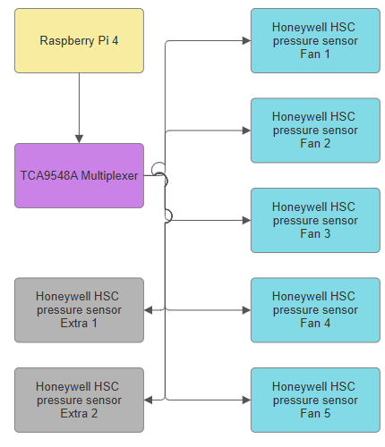
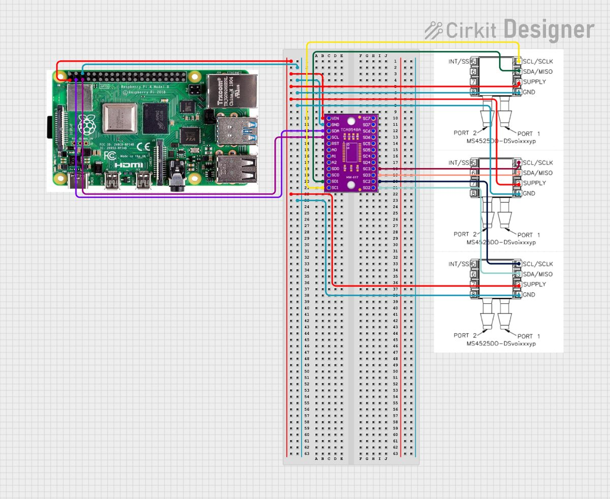
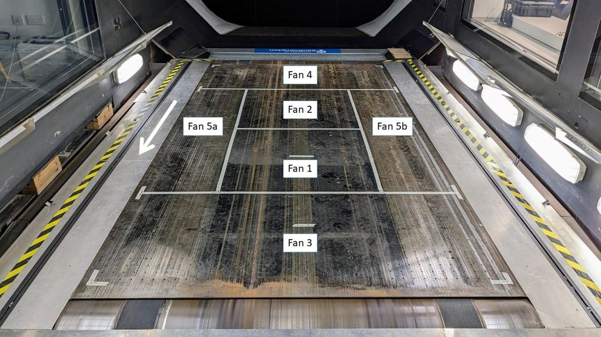
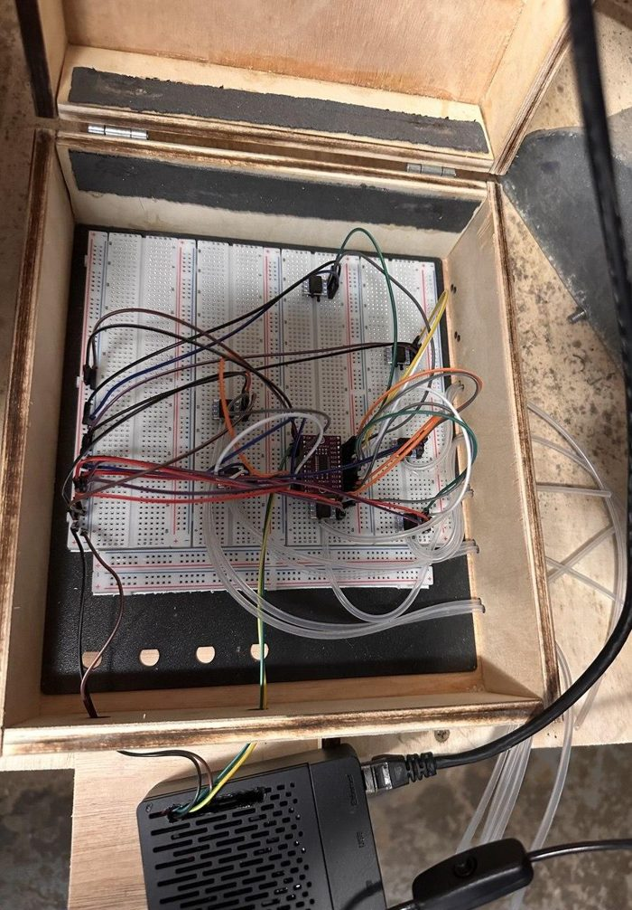

# Hardware

## Design choices

The first idea was a fully industrial system: an aerospace Electronic Pressure Scanner and a PLC,
designed for three years without maintenance. That was far too expensive for a university facility
and PLCs are poor at the floating-point maths and graphical interface this job needs. The design
moved to an **Industrial Internet of Things (IIoT)** approach instead: a single-board computer and
digital sensors, a one-year service cycle with planned maintenance, and a custom enclosure to deal
with the dust and knocks of the tunnel sub-floor.

| decision | why |
|---|---|
| **Raspberry Pi 4 (4 GB)** instead of a PLC or Arduino | runs Linux and Python, so it can handle networking, the maths and a GUI at the same time; the 4 GB model leaves plenty of headroom so the alert logic never lags |
| **Digital I²C sensors** instead of analogue | the tunnel's large induction motors create electrical noise; analogue signals over long cables pick it up, digital ones do not |
| **I²C** instead of SPI | I²C needs 2 wires for any number of sensors; SPI needs an extra chip-select wire per sensor running along the sub-floor |
| **TCA9548A multiplexer** | identical sensors share one fixed I²C address; the multiplexer switches between 8 channels so the Pi can read each sensor in turn in milliseconds |
| **Sensors in a box, connected by tubing** | the sensors' silicon diaphragms would not survive under the belt; tubes from the existing pressure taps keep them in a protected enclosure, and the long, thin tubes also stop dust and filter out turbulent noise |
| **Laser-cut plywood enclosure** instead of 3D-printed PLA | rigid under vibration, barely expands with heat, cheap and quick to make |

## System diagram

  
  

The Raspberry Pi is the I²C bus master. It tells the TCA9548A which channel to open, reads that
sensor, then moves to the next one. The breakout board also translates between the Pi's 3.3 V logic
and the sensors. The wiring diagram shows 3 of the 7 sensors for readability; the others are wired
the same way.

## The sensors

**Honeywell HSCDRRN400MD2A3** (HSC series): differential, ±400 mbar range, 3.3 V supply, I²C
output. Inside, four piezoresistive strain gauges etched into a silicon diaphragm form a Wheatstone
bridge; when suction flexes the diaphragm the resistances change, and an on-chip 24-bit ADC and
ASIC turn that into a temperature-compensated digital reading. That is why each reading also
carries a temperature.

## Sensor placement

The belt is held down by five sub-floor suction fans, each covering its own area of the platen
(Fan 5 covers both sides). One sensor is connected to a pressure tap in each fan zone, so a loss of
suction anywhere on the belt shows up on at least one channel, including a detachment between two
fans. Two extra channels (Extra 1 and 2) are free for additional taps.

## Enclosure

The breadboard, multiplexer, sensors, wiring and tubing sit inside a hinged laser-cut plywood box
with strain relief for the cables and tubes. The Raspberry Pi sits outside the box in a GeeekPi ABS
case with its own fan, which kept the processor well below its throttling temperature during
testing.

## Bill of materials

| item | part | qty | cost |
|---|---|---:|---:|
| Controller | Raspberry Pi 4 Model B, 4 GB | 1 | £66.18 |
| Multiplexer | TCA9548A I²C multiplexer breakout, 400 kHz | 1 | £7.99 |
| Power supply | Raspberry Pi 15 W USB-C (5.1 V / 3 A) | 1 | £7.20 |
| Storage | 32 GB microSD with Raspberry Pi OS | 1 | £9.00 |
| Tubing | 1.6 mm ID × 3.2 mm OD silicone tubing, 5 m | 2 | £15.38 |
| Breadboard | 3220-point solderless breadboard | 1 | £22.49 |
| Pressure sensors | Honeywell HSCDRRN400MD2A3 | 8 | £254.40 |
| Case | GeeekPi ABS case for Raspberry Pi 4 | 1 | £9.89 |
| **Total** | | | **£392.53** |

Eight sensors were bought for seven channels, leaving a spare.

## Safety

Installation followed an approved risk assessment and method statement. The biggest risk,
entanglement with the belt (which runs at up to 50 m/s), was reduced from 25/25 to 8/25 with a
Lockout-Tagout (LOTO) procedure: power to the belt drive and main fan was isolated before anyone
went under the floor. The whole system runs on low-voltage DC, so no mains wiring was needed inside
the test section.

**If you reuse this design, follow your own facility's safety procedures.** This monitor is an
early-warning aid for operators, not a certified safety system.
